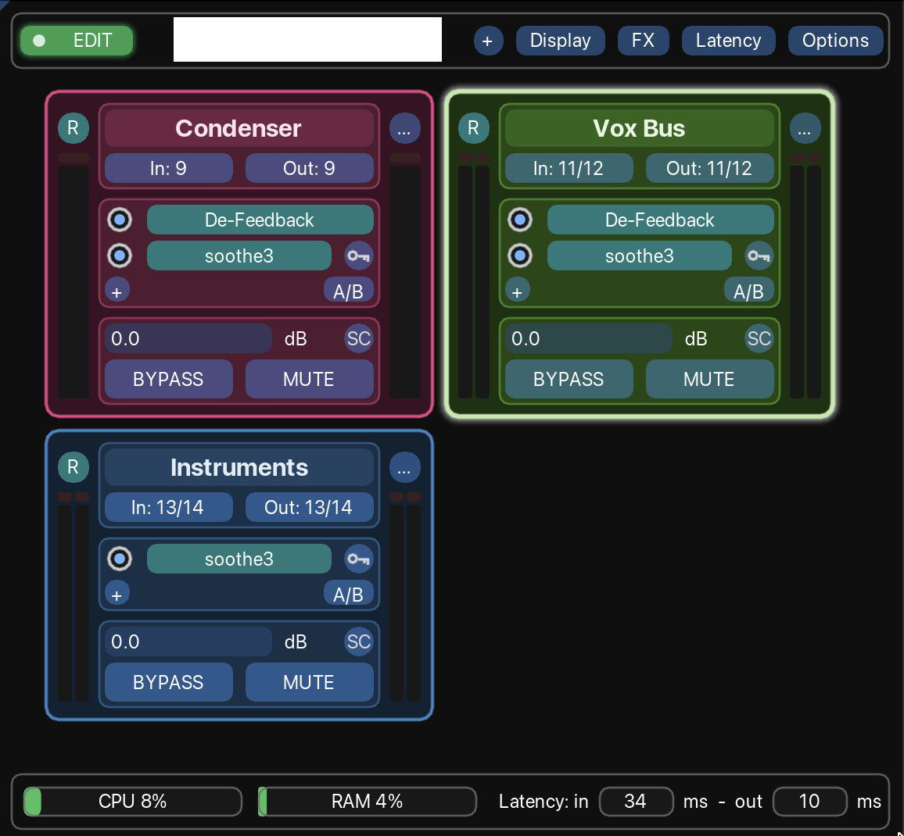

# FOH-Mate

Live sound tools for [REAPER](https://www.reaper.fm).

> **A note on the name.** This project was previously called *Live Rack*. It has been renamed
> **FOH-Mate** (file name `FOHMate`) to avoid confusion with an existing trademark, and is not
> affiliated with it. The rack panel is now the **Plugins Host** module of FOH-Mate. Your settings and
> data carry over automatically. FOH-Mate is an independent open-source project, not affiliated with or
> endorsed by Cockos Incorporated; REAPER is a trademark of Cockos.

**Plugins Host** is the first module: a rack-based FX panel for REAPER, made for live sound.

Plugins Host turns a handful of REAPER tracks into **racks**: strips with their own input and output
routing, a chain of FX, a level, mute and bypass, and input/output meters. All racks live in one
window, away from your playback tracks, so the mixer and the track view stay clean.

> **Status: work in progress (v0.x).** It is used and tested on macOS with REAPER 7.81. Windows and
> Linux are untested. Expect rough edges and changes between versions.


<!-- Add a screenshot of the window at docs/screenshot.png -->

**Contents:** [What it does](#what-it-does) · [Quick start](#quick-start) · [Requirements](#requirements) ·
[Installation on a fresh REAPER](#installation-on-a-fresh-reaper) · [Using FOH-Mate](#using-foh-mate) ·
[Good to know](#good-to-know) · [Troubleshooting](#troubleshooting) ·
[Updating and uninstalling](#updating-and-uninstalling)

---

## What it does

- **Racks are tracks.** Any track whose name starts with `RACK:` becomes a rack. FOH-Mate hides it
  from the track list and the mixer, keeps it off the master, and shows it in its own window.
- **Everything about a rack in one strip:** name, input and output routing, FX chain, level (dB),
  BYPASS, MUTE, and input/output meters with peak hold and clip markers.
- **Edit and Show modes.** A cue-light switch (green = Edit, red = Show) locks the racks and their FX
  while you perform. Level, mute, bypass and FX on/off keep working.
- **Quick FX handling.** Add, insert, replace, delete, reorder, copy and move FX between racks with
  menus and drag and drop.
- **Level match.** Measures a rack's input and output (RMS) and sets its level so the output matches
  the input.
- **Sidechains without the routing maze.** A key button on every FX that has a sidechain input
  picks a hardware input or a sidechain bus; any rack can feed sidechain busses.
- **Mono, stereo and mono-to-stereo racks,** set by the rack's routing: the FX switch to their mono
  or stereo version on their own, keeping their settings.
- **Duplicate a rack** (from its menu or by dragging it), **or use it as a template** (same FX,
  default parameters).
- **Rack colors,** automatic or picked by hand, plus a **Daylight** theme for bright rooms.
- **Latency watchdog.** Racks and FX that add more latency than your limit flash **!!**; FX you
  accept can be allowed, and alerts can be silenced for a while or switched off.
- **Status bar** with CPU and RAM gauges, REAPER's latency, latency alerts, and rack and FX counts.

---

## Quick start

Starting from a fresh REAPER? Do [Installation](#installation-on-a-fresh-reaper) first (about ten minutes,
most of it ReaPack and ReaImGui). Once FOH-Mate is loaded as an action, this is the shortest way from an
empty window to a working rack:

1. **Run it.** In **Actions > Show action list...**, select **Script: FOHMate_v0.11.9.lua** and click **Run**.
   On a new project the window is empty.
2. **Create a rack.** Click the round **+** at the top right of the window (or double-click empty space).
   "Rack 1" appears. Behind the scenes it is a new track named `RACK: Rack 1`, hidden from REAPER's track
   list. *Already have a project?* Rename any track to `RACK: something` and it becomes a rack.
3. **Name it.** Double-click the rack's name and type.
4. **Route it.** Click **In:** to choose an input (mono, stereo or MIDI) and **Out:** to choose a hardware
   output.
5. **Add FX.** Click the round **+** in the rack's FX section and pick an FX from **Developers** or
   **All FX**. Click its button in the rack to open the plugin window.
6. **Play something through it.** The input meter is on the left, the output meter on the right. Set the
   level in the dB box, or use **... > Level match**.
7. **Add more racks.** Click **+** again, or use **... > Duplicate rack** to copy a rack with everything in it.
8. **Before the show:** click the green **EDIT** switch at the top left so it turns red (**SHOW**). The racks
   are now locked against accidents. Level, mute and bypass still work.

---

## Requirements

| What | Notes |
|---|---|
| [REAPER](https://www.reaper.fm) 7.x | Developed on 7.81. Older versions are not tested. |
| [ReaPack](https://reapack.com) | Used to install ReaImGui. |
| [ReaImGui](https://github.com/cfillion/reaimgui) | The graphics library FOH-Mate is built with. |

No other extensions are needed (SWS is not required).

---

## Installation on a fresh REAPER

### 1. Install REAPER

Download it from [reaper.fm](https://www.reaper.fm/download.php), install it, and start it once so it
creates its folders. It runs in evaluation mode until you buy a license.

### 2. Install ReaPack

ReaPack is an extension that installs scripts and extensions from inside REAPER.

1. Download the ReaPack file for your system from [reapack.com](https://reapack.com).
   Pick the one that matches your REAPER (for example Apple silicon vs. Intel on a Mac, 64-bit on
   Windows).
2. In REAPER, open **Options > Show REAPER resource path in explorer/finder**. Open the
   **UserPlugins** folder inside it.
   - macOS: `~/Library/Application Support/REAPER/UserPlugins`
   - Windows: `%APPDATA%\REAPER\UserPlugins`
   - Linux: `~/.config/REAPER/UserPlugins`
3. Copy the ReaPack file into **UserPlugins** and **restart REAPER**.
4. You should now have **Extensions > ReaPack**. On the first launch it may open a settings dialog;
   you can just close it.

> If macOS blocks the extension because it was downloaded from the internet, allow it in
> **System Settings > Privacy & Security**, then restart REAPER.

### 3. Install ReaImGui

ReaImGui comes from the default **ReaTeam Extensions** repository, which ReaPack already knows.

1. **Extensions > ReaPack > Browse packages...**
2. Type `imgui` in the filter box.
3. Right-click **ReaImGui: ReaScript binding for Dear ImGui** and choose **Install**.
4. Click **Apply** (bottom right), then **restart REAPER**.

### 4. Get FOH-Mate

1. Download `FOHMate_v0.11.9.lua` from this repository (it is a single file).
2. Copy it into REAPER's **Scripts** folder: **Options > Show REAPER resource path...** and open the
   **Scripts** folder.

### 5. Load it as an action

1. **Actions > Show action list...**
2. Click **New action... > Load ReaScript...**
3. Choose `FOHMate_v0.11.9.lua`.

### 6. Run it

In the action list, find **Script: FOHMate_v0.11.9.lua** and click **Run**. The Plugins Host window opens.
It can float, or be docked (see [Docking](#docking)).

To make it easy to reach, right-click a toolbar and add the action, or assign it a shortcut.
To open it automatically when REAPER starts, set it as a startup action (for example with the SWS
extension's *Global startup action*).

### First run: what happens

- FOH-Mate writes its small meter plugin (a JSFX) to
  `<REAPER resource path>/Effects/FOHMate/FOHMate_Meter`. You do not need to install it yourself.
- If the window shows no racks, click the round **+** in the top bar (or double-click empty space) to
  create your first rack.
- Existing tracks are untouched. A track only becomes a rack when its name starts with `RACK:`.

---

## Using FOH-Mate

### A rack at a glance

```
 (R)  [      Rack name      ]  (...)      R   = routing window
  |   [ In: 1   |  Out: 1/2 ]   |        ... = Rack Option Menu
  |   ------------------------   |
  |   (o) FX one                 |        (o) = FX on/off, click a name to open the FX window
  |   (o) FX two                 |
  |   (+)               [A/B]    |        + = add an FX, A/B = invert every FX on/off
  |   ------------------------   |
  |   [ 0.0            ] dB      |
  |   [ BYPASS ]  [ MUTE ]       |
 input meter                output meter
```

- **Name:** click to select the rack, double-click to rename, drag to reorder.
- **In / Out:** pick the hardware input (mono, stereo or MIDI) and the hardware output.
- **R:** opens REAPER's own routing window for the rack, for sends and receives.
- **FX:** click a name to open or close the plugin window. The dot turns one FX on or off.
- **Level box:** type a value in dB (a comma works as the decimal mark, `-inf` is allowed).
  Shift + double-click resets it to 0 dB; Alt-click (Option-click) sets 0 dB, or -inf when it is
  already at 0 dB.
- **SC** (next to the level): sends the rack to sidechain busses (see *Sidechains* below).
- **Key button** (at the end of an FX row, only on FX that have a sidechain input): picks what
  drives that FX's sidechain.
- **BYPASS** turns every FX off and restores them as they were when you click it again.
- **Meters:** input on the left, output on the right. White lines show the peak hold; the box on top
  lights red on a clip. Click any meter to reset all of them.

### Mouse and keyboard

| Action | Result |
|---|---|
| Click a rack's name | Select that rack |
| Cmd/Ctrl-click a rack's name | Add the rack to the selection, or remove it |
| Click empty space | Deselect the racks |
| Double-click empty space | Asks whether to create a new rack |
| Double-click a rack's name | Rename the rack |
| Drag a rack by its name | Reorder racks. Drop in the empty space to move it to the last position |
| Hold Cmd/Ctrl while dropping a rack | Duplicate it at the drop position |
| Drag an FX inside a rack | Reorder the FX |
| Drag an FX onto another rack | Copy it there |
| Hold Cmd/Ctrl while dropping an FX | Copy |
| Hold Alt while dropping an FX on another rack | Move |
| Right-click an FX | Insert FX, Replace FX, Delete FX..., Allow latency |
| Shift + double-click the dB box | Reset the level to 0 dB |
| Alt-click (Option-click) the dB box | 0 dB, or -inf when already at 0 dB |
| Click a meter | Reset every peak hold line and clip marker |

The copy and move keys can be changed in **Options > Settings...**

### Edit and Show modes

The switch at the top left of the main bar toggles the mode (it is remembered between sessions).

| | Edit (green) | Show (red) |
|---|---|---|
| Level, mute, bypass, FX on/off, A/B | yes | yes |
| Open plugin windows | yes | yes |
| Select racks | yes | yes |
| Create, rename, reorder, recolor racks | yes | locked |
| Routing (In / Out / R) | yes | locked |
| Add, insert, replace, delete, move, copy FX | yes | locked |
| Rack Option Menu | yes | locked |

### Selecting racks

Click a rack's name to select it, and Cmd-click (Ctrl-click on Windows) to add or remove racks from
the selection. Selection is REAPER's own track selection, so both stay in sync. Selected racks glow.
Click empty space to deselect.

### The Rack Option Menu (the `...` button)

| Item | What it does |
|---|---|
| Level match | Listens for 3 seconds and sets the level so output matches input. Play a typical signal. |
| Duplicate rack | Copies the rack with everything: FX, parameters, routing, level. |
| Use as template | Same rack and FX, but every FX is re-added with default parameters. |
| Recolor automatically | Picks a color that contrasts with the racks before and after. |
| Choose color... | Opens a color picker. |
| Remove every FX / Remove bypassed FX | Cleans out the chain. |
| Revert to regular track | Makes it a normal track again: name prefix removed, back in the track list and mixer. |
| Delete rack... | Deletes the track, after a confirmation. |

If you open the menu on a **selected** rack, the action applies to **all selected racks**, after a
confirmation. Everything is undoable with REAPER's undo.

### Adding and changing FX

- **+ button** (or right-click an FX > **Insert FX**): a menu of your installed FX. Every entry shows
  its type before the name (`VST3: ...`, `AU: ...`, `JS: ...`), so versions of the same plugin can be
  told apart. The menu is grouped by your FX browser folders, developers, and type.
- **Right-click an FX:** *Insert FX* (before this one), *Replace FX* and *Delete FX...* (both ask first).
- **Drag an FX** to reorder it. Drop it on another rack to copy it there. Hold **Ctrl/Cmd** to copy,
  **Alt** to move. While a drop would copy, a green **+** follows the pointer and the drop target is
  outlined in green.
- **Search:** every FX menu (**+**, *Insert FX*, *Replace FX*) starts with a search field, ready to
  type in. Half a second after you stop typing, the menu shows the FX whose name contains every word
  you typed; **Enter** picks the first one.
- In the menus each FX shows its **type** (VST3, AU, CLAP, JS...) on the right in that type's color, and
  its known **latency** in red after its name. Colors are set in **FX > FX type colors...**.
- **FX > FX types** limits the menus to the FX types you use, with a count for each type.

### Sidechains

- **Key button** on an FX row opens its sidechain menu: *None*, *Mono Input* (any hardware input),
  *Stereo Input* (any input pair; summed to mono when the FX has a mono sidechain) and *Bus* (every
  sidechain bus, plus *Create new bus...*). The button lights up when a key is set; hover it to see
  the source.
- **SC button** (next to the level) lists the sidechain busses: tick one to send the rack to it and set
  the send level with its slider. *Create new sidechain bus...* makes one and sends the rack to it.
  Right-click a bus name to rename or delete it. The send is taken after the rack's FX and before its
  level, so riding the level or level matching never changes how hard a key hits.
- **Sidechain busses** are hidden tracks named `SC BUS: <name>`. They never go to the master and have
  no hardware input or output.
- **Hardware inputs** used as keys go through a hidden `SC IN: <input>` track (one per input, shared
  by every FX keyed from it). FOH-Mate creates and removes these on its own.
- Choices that would make a feedback loop (a rack keyed from a bus it feeds) are greyed out.
- Under the hood, each keyed FX gets its own pair of track channels (3/4, 5/6, ...), so FX can be
  reordered freely. Everything is regular REAPER routing, visible in the routing window.

### Dragging racks

Drag a rack by its name. A see-through copy follows the cursor and the rack under it is outlined.
Drop it on another rack to place it there, or in the empty space around or below the racks to send it
to the last position. Racks follow your project's track order.

Hold **Ctrl/Cmd** (the copy key) when you drop to **duplicate** the rack instead: the copy lands where
you drop it, or right after the original if you drop it on itself. A green **+** follows the pointer
and the target is outlined in green while a drop would copy.

### Mono and stereo racks

A rack's width comes from its routing, separately for each side, so a rack can be mono in and stereo
out:

- **Input side:** the hardware input (mono or stereo). With no input, the receives: mono when every
  receive is mono, stereo otherwise.
- **Output side:** the hardware outputs (mono when they are all mono). With none, the sends; with no
  outputs at all, the same as the input side.
- The **meters follow**: one bar for a mono side, two for a stereo side. Hover **In** or **Out** to
  read the width.

What the FX get:

| Rack | FX |
|---|---|
| mono in, mono out | every FX mono |
| stereo in (any out) | every FX stereo; a mono output sums the two sides at the hardware output |
| mono in, stereo out | mono up to the **stereo point**, stereo from there on |

The **stereo point** is the FX where the chain turns stereo, marked by a line above it. By default it is
the first FX that comes in a mono-to-stereo version (a reverb, for example). Right-click any FX >
**Stereo from here** to pick it yourself; **Stereo point: automatic** goes back to the default. With
no stereo point the whole chain stays mono and the output carries it on both sides.

How an FX changes width, best option first:

1. **The plug-in's bus size** (VST3 mostly; the same as **Plug-in bus size** in REAPER's pin
   connector): 1 on the mono part of a rack, 2 on the stereo part. The plug-in stays in place with all
   of its settings. A sidechain input nobody assigned a key to is left unconnected, so a mono plug-in
   never keys from its own signal.
2. **Its sibling version** when one is installed, recognised by a name that ends in *Mono*, *Stereo* or
   *Mono/Stereo* (the Waves style, e.g. `C6 Mono` / `C6 Stereo`). It is swapped in place and every
   parameter with the same name is copied over, so settings carry across; anything the other version
   does not have is left at its default. Its sidechain key, on/off state and open window follow.
3. Otherwise the FX stays as it is (a stereo-only plug-in on a mono rack just gets the same signal on
   both sides).

Versions are swapped when a rack's routing or stereo point changes (from FOH-Mate's menus or from
REAPER's routing window) and on FX added, copied or moved into a rack. An FX you change by hand in
REAPER afterwards is left alone until the routing changes again. The output of a mono FX feeds both
track channels, so outputs, sends and meters always agree.

### Color and Daylight

- **Display > Recolor every rack** colors all racks, starting from a random color, each contrasting
  with the previous one.
- **Display > Choose default color...** and **New racks use automatic / default color** decide the color of racks
  you create or copy.
- **Display > Daylight mode** switches the whole panel to a light theme for bright rooms. Each rack's own color
  is kept as a pale tint with a solid name label.

### Docking

Use **Display > Dock** to put the window in one of REAPER's dockers, or back to floating. You can also
drag the window onto a docker. The window remembers its dock.

### Menus

The top bar, right side: **+** (new rack), then four menus.

| Menu | What is in it |
|---|---|
| **Display** | Daylight mode, Rack latency box (off / always / only with latency), rack colors, Dock |
| **FX** | FX types, FX type colors, Hide FX over the latency limit, Take FX over the limit offline in Show mode |
| **Latency** | Latency alerts, Silence / Resume, Latency limits, FX latency list, Open the FOH-Mate data folder, Scan new / Rescan all FX, Ask to scan new FX |
| **Options** | Disconnect inputs/outputs on copy and template, Disable metering and Level match, Settings... |

Windows (Settings, FX latency list) reopen at the size you left them, also after being collapsed.

### Status bar

CPU and RAM gauges, **Latency: in [..] ms - out [..] ms** as reported by REAPER, the latency alert line
(see below), and the rack and FX counts. Hover a gauge for details.

### Latency watchdog

FOH-Mate keeps an eye on the latency each rack adds (every FX reports its own, in samples):

- When a rack's FX add up to more than the **latency limit**, a red **!! x.x ms** tag flashes on the
  rack's top edge and a **!!** flashes on every FX that adds latency. Hover the tag for the list of
  culprits; hover any FX to read its latency. The status bar flashes how many racks are over.
- **Right-click an FX > Allow latency** for an FX you accept (a look-ahead limiter, say). Its latency
  is no longer counted, in this rack or any other, in every project: the mark is kept in the FX
  latency list (below), and carries over to its mono/stereo version.
- **Display > Rack latency box** adds a box across the bottom of every rack with its latency in ms
  and samples (red when over the limit): **Always**, **Only when a rack has latency**, or **Off**. Hover it for each FX's share and REAPER's own figure for the
  chain. It updates once a second, and right away when FX are added or removed.
- There are **two limits**, set in **Latency > Latency limits...**, in samples: one **per FX** and one
  **per rack** (several small latencies can add up). A rack alerts when one FX is over the per-FX limit
  or when its FX together are over the per-rack limit. Both default to 0: any added latency raises an
  alert.
- **Latency > Silence latency alerts for N min** quiets them for a while (the length is set in
  Settings and holds even if FOH-Mate is restarted); **Resume latency alerts** ends it early.
  **Latency > Latency alerts** switches them off completely. While silenced or off, the status bar says
  so and the **Latency** button turns red.
- Alerts show in both Edit and Show mode. FX that are switched off or offline don't count: REAPER
  drops their latency from its compensation too.
- **Which limit?** When an FX is over the per-FX limit, that FX flashes **!!** and the rack tag reads
  **!! FX**. When the FX are each fine but add up to more than the per-rack limit, the rack's whole
  frame flashes red, the tag reads **!! RACK**, and only the FX adding the most latency flashes.

#### The FX latency list

FOH-Mate keeps one list of FX and the latency they report, shared by every project on the computer
(`Data/FOHMate/fx_latency.txt` in REAPER's resource folder; **Latency > Open the FOH-Mate data
folder** shows it, with the scan log and the last error report). Every FX loaded in a rack is added or
updated as it is seen; a scan can fill it in for everything installed. **Latency > FX latency list...**
shows it: latency (last reported, and the highest seen), whether the FX is allowed, and where the
number comes from (*scan*, *seen* in a rack, or *failed* to load). Tick **Allowed** there too.

- **Latency > Scan new FX for latency...** measures the effects not measured yet; **Rescan all FX
  for latency...** measures them all again (the only way an FX is measured twice), leaving out FX that
  failed before; **Retry failed FX...** tries those again. Each result is saved the moment it is
  measured, and if a scan doesn't finish (a crash, or REAPER closed), the next start offers to
  **continue it** where it stopped. Each effect is loaded once on a temporary hidden track,
  read and removed, with a progress window and a **Stop** button. Instruments are skipped. Scans run in
  Edit mode only.
- Two settings in **Settings > Latency** tune the scan: a **pause between FX** (raise it if scans crash
  REAPER often) and an **extra wait for AUs** that report no latency at first.
- **Do it when nothing is live** (audio may glitch while plug-ins load) and **save first**: a plug-in
  that crashes on load can take REAPER down. If that happens, the next time FOH-Mate opens it tells
  you which plug-in it was, marks it *failed* and skips it in later scans. The scan window always
  shows the plug-in being loaded, and every scan is logged, in order, in
  `Data/FOHMate/last_scan_log.txt` in REAPER's resource folder.
- Most effects really have no latency, so a scan showing mostly zeros is normal; look-ahead limiters,
  linear-phase EQs and oversampling are the usual exceptions. Each plug-in is measured with its
  default settings.
- **New plug-ins:** when you start FOH-Mate (and once a minute after), it looks for effects that are
  not in the list and offers to scan them. **Latency > Ask to scan new FX** turns the question off.
- A few plug-ins only settle their latency once audio runs through them or once a setting changes
  (look-ahead, oversampling): the number seen in a rack then updates the list.
- **FX > Hide FX over the latency limit** leaves FX whose known latency is over the per-FX limit (and
  that are not allowed) out of the **+**, *Insert FX* and *Replace FX* menus. It follows the limit
  when you change it.
- **FX > Take FX over the limit offline in Show mode:** switching to Show takes offline every FX over
  the per-FX limit, then, rack by rack, the FX adding the most latency until each rack is back under
  the per-rack limit.
  Offline means unloaded, so their latency is really gone; audio passes through them untouched. Their
  name is struck through. Switching back to Edit brings them back online (it can take a moment for
  big plug-ins to reload).

### Settings

**Options > Settings...** opens a window with the values you can change: automatic color ranges, meter
range and fall speed, Level match time and gate, latency limits and silence time, FX type colors,
copy and move keys, corner rounding, and the
dimensions of the racks (grouped under *Layout*). Changes apply immediately and are saved. Ctrl+click
a slider to type a value. **Reset to defaults** restores everything.

---

## Good to know

- **Racks never go through the master.** FOH-Mate keeps the master send off on every rack, and on
  the sidechain tracks (`SC BUS:` and `SC IN:`).
- **Hidden tracks.** Racks are hidden from the track list and mixer on purpose. To bring one back, use
  **Revert to regular track**.
- **Meter plugins.** Each rack gets two small meter JSFX, one first and one last in its chain. They
  never show in FOH-Mate's FX list. If you open a rack's FX chain in REAPER you will see them.
- **Opening a project on another computer** without FOH-Mate: the meters show up as missing plugins.
  This does not affect the audio.
- **CPU and RAM** come from the operating system (REAPER does not expose its Performance Meter to
  scripts). On macOS and Linux they show REAPER's share of the machine. On Windows the gauges show
  `n/a`. REAPER does not report processing time to scripts, so the status bar shows latency instead.
- **Saved settings** live in REAPER's own settings file. Each rack's bypass state is saved in the
  project. On macOS and Linux a tiny file (`/tmp/FOHMate_stats.txt`) is used for the CPU and RAM
  numbers.

---

## Troubleshooting

| Problem | What to try |
|---|---|
| "ReaImGui is not installed" | Follow [step 3](#3-install-reaimgui), then restart REAPER. |
| Any other error after a ReaImGui update | Update the script too, or report it with the file, line number and message. |
| In / Out menus show no channels (red note at the top) | REAPER reports no inputs or outputs: the audio device is not running, failed to open (in use elsewhere, sample rate refused), or its channel range is off. Check **Preferences > Audio > Device**; the note names the device REAPER is using. |
| "Could not add the meter JSFX" | Restart REAPER, or refresh the FX list (**Options > Preferences > Plug-ins > VST**, then re-scan). |
| Meters do not move | Check that audio is flowing through the rack. The output meter shows the level after the fader. |
| Something odd with racks or sound | **Options > Disable metering and Level match.** This also removes the meter plugins from the racks, to rule them out. Turn it off to bring them back. |
| CPU / RAM show `n/a` | They need macOS or Linux. See *Good to know*. |
| The window opens tiny or in the wrong place | Resize or dock it again. REAPER remembers windows by name. |
| A rack disappeared | It is hidden on purpose, but still a track named `RACK: ...`. Check the track list with *show hidden tracks* or the Track Manager. |

If you hit an error, the ReaScript error dialog shows the file, the line number and the message.
Please include all three in a bug report.

---

## Updating and uninstalling

- **Update:** replace the script file with the new one and re-run it. If the file name changed (it
  includes the version), load the new file in the action list and remove the old action.
- **Coming from Live Rack:** load `FOHMate_v...lua` in the action list and remove the old `LiveRack_v...lua`
  action. Your settings, favorites and latency list are copied over the first time FOH-Mate starts, and
  your racks keep their saved data. Once everything checks out you can delete the old
  `<REAPER resource path>/Data/LiveRack/` folder.
- **Uninstall:** use **Revert to regular track** on racks you want to keep as normal tracks, remove the
  script action, delete the script file, and optionally delete
  `<REAPER resource path>/Effects/FOHMate/`.

---

## Contributing

**Version numbers** are *major.minor.revision*: the revision goes up for small fixes and adjustments,
the minor number for new features or bigger changes. The current version is shown in the window's
title bar (next to the Plugins Host title) and in the file name.

Issues and pull requests are welcome. When reporting a bug, please include the FOH-Mate version
(shown next to the Plugins Host title), your REAPER version, operating system, ReaImGui version, and the
exact error message.

By contributing you agree that your contribution is licensed under the same terms as the project
(see below).

## License

FOH-Mate is free software, licensed under the **GNU General Public License, version 3 or (at your
option) any later version** (GPL-3.0-or-later). See the [LICENSE](LICENSE) file.

You are free to use, study, share and modify it. If you distribute a modified version, or a larger
work that includes it, you must make the source available under the same license.
